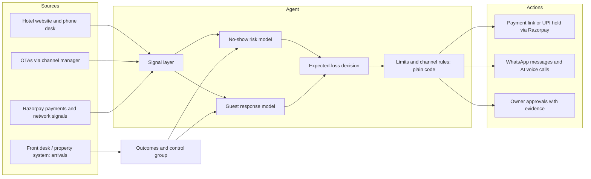

# Guarantee Agent

**An agent for Razorpay Agent Studio that decides, booking by booking, what a hotel guest should pay upfront, so hotels stop losing rooms to cancellations and no-shows without losing bookings.**

[**Live prototype**](https://guarantee-agent-prototype.vercel.app) · [**Product walkthrough video**](https://drive.google.com/file/d/1ib39a6STp9PHmeCNZgH8qW3Px_kqabIz/view?usp=sharing) · Razorpay AI PM Build Challenge, Track 2: Recover and Grow with AI

---

## The problem

A pay-at-hotel guest who never arrives leaves an empty room and nothing collected. Hotels have only blunt tools today: ask everyone to prepay (and lose guests at checkout), ask no one (and absorb every no-show), apply one blanket rule, or have the front desk call down a list.

## What the agent does

For every booking, on every channel, the agent runs five steps:

| Step | What happens |
| --- | --- |
| **Detect** | Picks up each booking the moment it lands, from the hotel's website, phone desk or any OTA through the channel manager |
| **Score** | Estimates the chance this guest cancels late or does not arrive, from guest history, booking shape, channel, hotel context and reachability |
| **Decide** | Picks the payment option that leaves the hotel with the most money: pay at hotel, a part payment, a first-night hold, or full payment |
| **Act** | Sends a Razorpay payment link or UPI hold on WhatsApp in seconds; OTA guests get reminders and AI voice calls instead |
| **Follow up** | Reminds and calls guests who go quiet; anything involving money, such as a no-show charge, waits for the owner's approval |

Decisions are instant, inside limits the owner sets. The owner approves only what moves money or changes policy.

## Product journey (the prototype)

| Screen | Purpose |
| --- | --- |
| Razorpay home and intro | Where the merchant meets the agent inside the Razorpay dashboard |
| Listing | What the agent does, shown as one guest's booking moving through the five steps |
| Connect tools | Razorpay, the hotel website, the channel manager, OTAs and WhatsApp, connected in one click |
| Rules and permissions | Limits recommended from the hotel's own last 90 days, each with a reason; what the agent may do and what it will never do |
| 90-day replay | Before anything is sent, the agent replays the hotel's past bookings to show what it would have saved, by hotel and by channel |
| Go live or pilot | A pilot on part of the group against the rest, or go live on every hotel |
| My Agents | The agent alongside the merchant's other Agent Studio agents, with recent activity |
| Overview | Three numbers and one chart: revenue gained, no-show rate, bookings saved |
| Bookings | Every decision explains itself: why, what the agent did and the result, plus the options it passed over |
| Approvals | Money moves and policy changes as decision cards, with the evidence on the card |
| Hotels and Settings | Per-hotel results; connected tools, rules, permissions, audit log and a pause button |

The prototype runs on a demo merchant (Radisson Hotels, 10 hotels) with demo data. Brand names are used for demonstration only.

## Architecture at a glance

The full design, including what is AI, what is plain code and what is the owner's call, is in [docs/architecture.md](docs/architecture.md). The decision itself is explained in [docs/decision-logic.md](docs/decision-logic.md).

## Repository

| Path | Contents |
| --- | --- |
| `index.html` | The complete clickable prototype, one self-contained file, deployed on Vercel |
| `docs/architecture.md` | Production architecture: data, models, decision, guardrails, actions, approvals, learning loop |
| `docs/decision-logic.md` | How the agent chooses a payment option per booking, with a worked example |
| `tools/walkthrough-video/` | The frame-accurate renderer that produced the walkthrough video from the live prototype |

## Run it

Open `index.html` in a browser, or serve the folder with any static server (`npx serve .`). There is no build step and no backend: every interaction runs in the page.

## How it was built

Built in 12 days by one person with Claude as the build partner: research with sub-agents, a design brief and decision log as shared context, three design directions on a canvas, a prototype generated by script from the design, automated browser checks for fit and transitions on six laptop sizes, and a walkthrough video rendered frame by frame (see `tools/walkthrough-video`).
