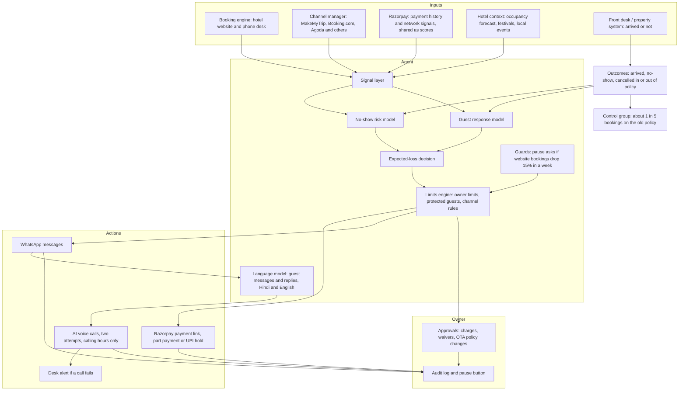
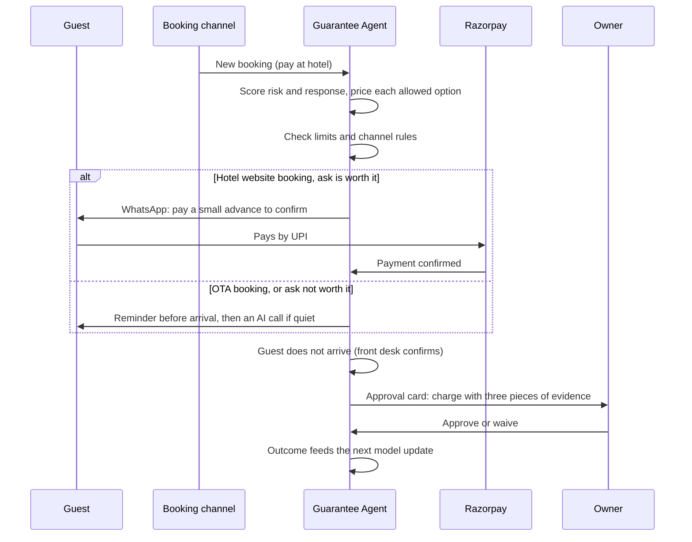

# Architecture

Guarantee Agent makes one decision per booking: what this guest should pay upfront. The design separates three kinds of work:

- **AI makes the judgements:** how likely a guest is to skip, and how likely they are to walk away if asked to pay.
- **Plain code enforces the commitments:** the owner's limits, protected guests, channel rules and guards. These are never learned.
- **The owner makes the money calls:** no-show charges, waivers, OTA policy changes and guard pauses.

## Components

| Component | Built as | Why |
| --- | --- | --- |
| No-show risk score | Supervised model (gradient-boosted trees), calibrated probabilities | Tabular data, modest volumes, reasons needed for every decision, and the rupee maths depends on honest probabilities |
| Guest response to being asked | Model trained on the control group and on varied asks | Learns who stays after being asked, so the agent never wins by blocking bookings |
| Choosing the option | Expected-loss calculation | A transparent formula the owner can follow, not a black box |
| Guest messages and replies | Language model | Replies arrive in free text and mixed languages ("late aunga, 9 baje") |
| Voice follow-ups | Automated voice agent | Replaces desk hours; hands over to the desk if the call fails |
| Limits, protected guests, channel rules | Plain code | Must be exact and auditable |
| Charging a no-show | Owner approval, always | Money moves only with the owner's tap |
| Pausing itself when bookings drop | Rule-based guard | A tripwire should be simple and predictable |

Sensitive attributes such as name, religion, gender or nationality are never model inputs.

## One booking, end to end

## Trust model

| The agent does on its own, inside limits | Always the owner's call | It will never |
| --- | --- | --- |
| Choose the payment option for each booking | Charge a no-show | Cancel a booking |
| Send payment links and UPI holds | Waive or refund | Charge a guest without approval |
| Send reminders and place calls | Change pay-at-hotel on an OTA for busy dates | Ask OTA guests for extra money |
| Pause full-payment asks when its guard trips | Resume after a guard pause | Go beyond the owner's limits |

Every decision is stored with its reasons: the score, the signals that moved it, the options it weighed and why it passed on them. That record is the explanation the owner sees on each booking, and the evidence if a guest disputes a charge.

## Proof before and after go-live

1. **90-day replay.** After setup, before anything is sent, the agent replays the hotel's own past bookings and shows what it would have saved, by hotel and by channel.
2. **Pilot.** The agent runs live on part of the group while the rest stay on the old policy, so the owner compares the two.
3. **Permanent control group.** About 1 in 5 bookings stays on the old policy, so the lift is always measured rather than assumed.

**North-star metric:** net room revenue per booking against the control group (revenue kept from no-shows, minus bookings lost by asking). **Guard metric:** website booking conversion, which must not fall.

## Where it sits in Razorpay

- **Agent Studio:** listing, install, permissions, approvals, audit log and pause follow the same pattern as Razorpay's other agents.
- **Payments:** payment links, part payments and UPI holds run on Razorpay, which moves cash-at-desk bookings onto prepaid rails.
- **Data:** "Will this booking no-show?" is a sibling of the delivery-risk question RTO Shield answers for e-commerce, with the same advantage of Razorpay's network view.
- **Partners:** channel managers and booking engines that already work with Razorpay are the route to hotels' booking data.
